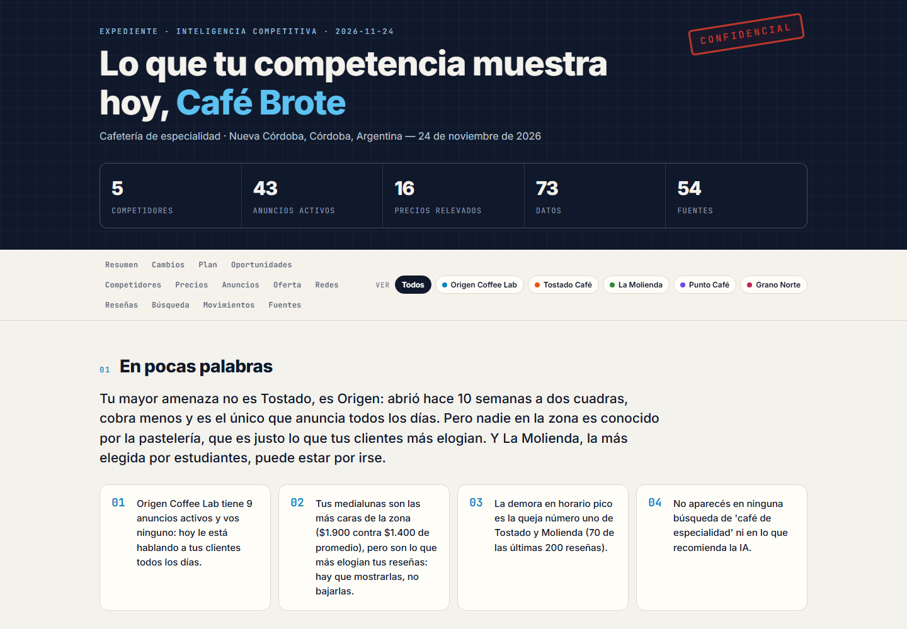
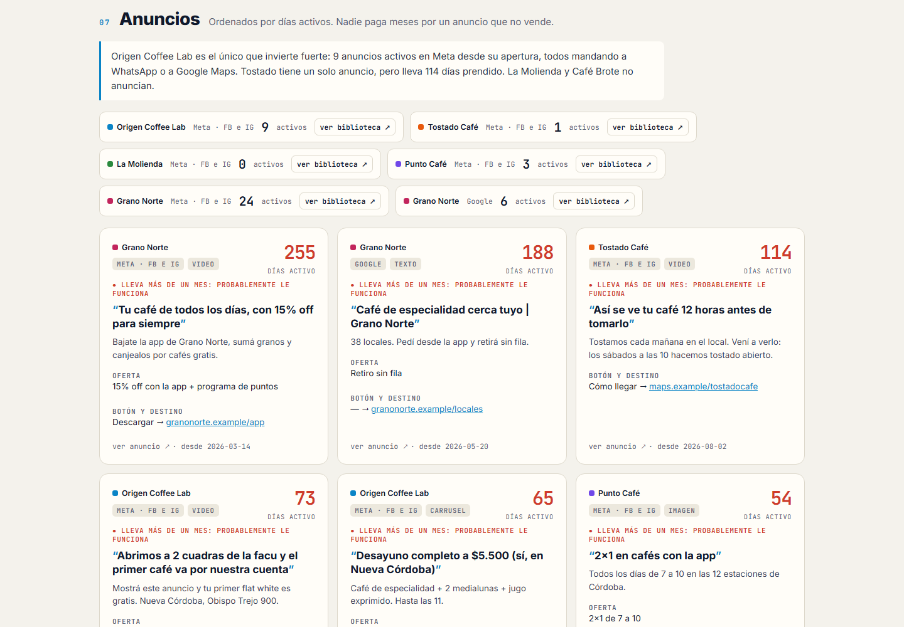
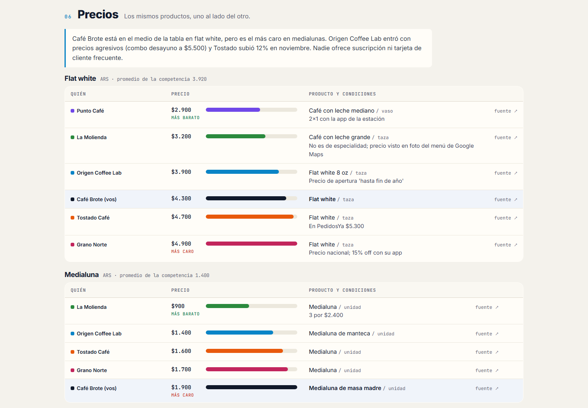
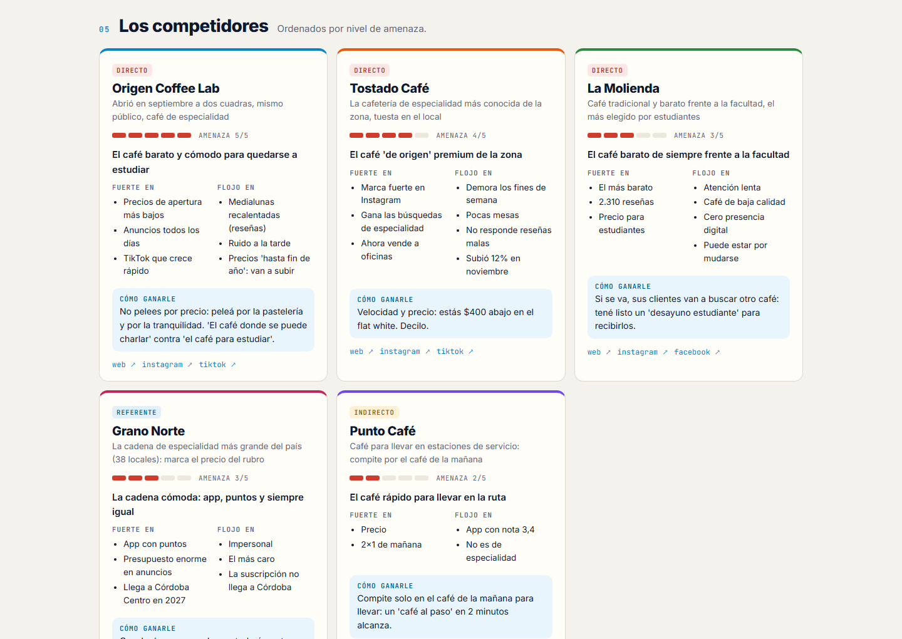
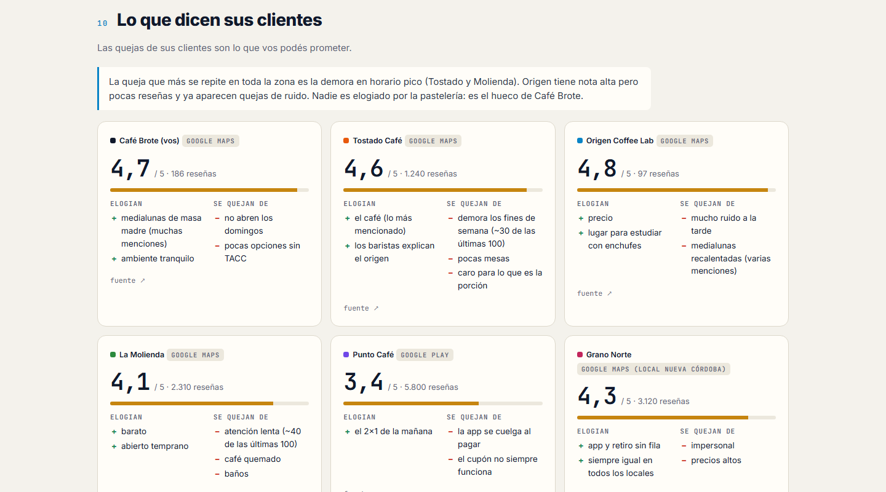

# Falcon

**Contale a Claude de qué es tu negocio y te trae todo lo que hace tu competencia hoy.**

Una skill de Claude Code que funciona como un agente de inteligencia competitiva. Le decís qué vendés y dónde (o le
pasás tu web). Encuentra a tus competidores y manda **7 agentes espía en paralelo**. Cada uno revisa un área de
todos tus competidores: cuánto cobran, qué anuncios tienen prendidos y desde cuándo, qué contenido les funciona, de
qué se quejan sus clientes, en qué búsquedas aparecen y qué están por lanzar. Te entrega un informe con fichas por
competidor, precios comparados, oportunidades y un plan de acción.

Sirve para **cualquier rubro**: una cafetería, un e-commerce, un software, un estudio contable, una clínica, una
inmobiliaria o una agencia.



| Anuncios ordenados por días activos | Precios comparados |
| --- | --- |
|  |  |
| **Ficha de cada competidor** | **Lo que dicen sus clientes** |
|  |  |

## Los 7 espías

| Agente | Qué trae |
| --- | --- |
| **Oferta** | Qué venden, su promesa, garantías, embudo (anuncio → WhatsApp → venta) y qué tecnología y píxeles usan |
| **Precios** | Los mismos productos uno al lado del otro, promos, cuotas, precio en apps y cuánto subieron (Wayback Machine) |
| **Anuncios** | Anuncios activos en Meta, Google, TikTok y LinkedIn, **cuántos días lleva cada uno**, ganchos, ofertas y a dónde mandan |
| **Redes** | Seguidores, ritmo, formatos y las publicaciones que mejor les funcionaron |
| **Reseñas** | Nota, cantidad, lo que elogian y **las quejas que se repiten** (lo que vos podés prometer) |
| **Búsqueda** | Quién aparece cuando tu cliente busca en Google, en Google Maps y en buscadores con IA |
| **Movimientos** | Lanzamientos, búsquedas laborales, aperturas, cierres, notas y cambios en su web |

Después un agente estratega lee todo y escribe: nivel de amenaza de cada competidor, cómo ganarle, oportunidades
(cada una con su evidencia), ángulos para tus anuncios y un plan de acción con lo que podés hacer **esta semana**.

## Instalación

### Claude Code (recomendado)

```
/plugin marketplace add nodestudioai/falcon
/plugin install falcon@nodestudio
```

O a mano, copiando la skill a tu carpeta de skills:

```bash
git clone https://github.com/nodestudioai/falcon.git
cp -r falcon/skills/falcon ~/.claude/skills/
```

### Claude.ai (web o escritorio)

1. Descargá `falcon.zip` desde [Releases](https://github.com/nodestudioai/falcon/releases/latest).
2. En Claude: **Configuración → Capacidades → Skills → Subir skill** y elegí el zip.
3. Activá la búsqueda web y la ejecución de código.

En claude.ai no hay subagentes, así que hace las 7 áreas una por una: tarda más, pero llega al mismo informe.

**Requisitos:** Python 3.8+ (sin librerías extra) y búsqueda web.

**Opcional, para ver más:**

- Un **navegador** conectado a Claude (Claude in Chrome o Playwright MCP): las bibliotecas de anuncios de Meta y
  Google se cargan con JavaScript y hace falta un navegador para leerlas. Sin navegador, el informe te deja el link
  directo a la biblioteca de cada competidor.
- El **MCP de Apify**: trae anuncios, perfiles de Instagram y TikTok y reseñas de Google Maps a escala. Usa créditos de
  Apify.

## Cómo se usa

> Espiá a mi competencia. Tengo una cafetería de especialidad en Nueva Córdoba, el flat white sale $4.300.

> Esta es mi web: https://mitienda.com. Quiero saber cuánto cobran y qué anuncios tienen mis competidores.

> Soy contador en Monterrey y atiendo pymes. ¿Qué está haciendo mi competencia?

> ¿Qué cambió en mi competencia desde la última vez?

Claude te hace como mucho 5 preguntas, te muestra la lista de competidores para que la confirmes y arranca. Todo
queda en `espia/<tu-negocio>/<fecha>/` y al final se abre `informe.html`.

### Modo vigilancia

Si lo corrés de nuevo otro día, compara contra la corrida anterior y te dice **qué cambió**: precios que subieron o
bajaron, anuncios nuevos y apagados, notas de reseñas, seguidores y movimientos nuevos. Podés dejarlo programado cada
semana con `/schedule`.

## Ejemplo incluido

En [`skills/falcon/ejemplo/cafe-brote`](skills/falcon/ejemplo/cafe-brote) hay un espionaje completo de una cafetería
**inventada** (Café Brote, con 5 competidores también inventados), con dos corridas para ver el modo vigilancia.
Descargá [`informe.html`](skills/falcon/ejemplo/cafe-brote/2026-11-24/informe.html) y abrilo para ver el resultado.

## Cómo funciona

```
tu negocio ──► Claude encuentra a la competencia ──► negocio.json
                                                        │
          ┌──────┬────────┬─────────┬───────┬─────────┬─┴────────┬─────────────┐
       oferta  precios  anuncios  redes  reseñas  búsqueda  movimientos   (7 agentes en paralelo)
          └──────┴────────┴─────────┴───┬───┴─────────┴──────────┴─────────────┘
                                  datos/*.json  (cada dato con fuente y fecha)
                                        │
                     estratega ──► sintesis.json ──► armar_informe.py ──► informe.html
```

- `skills/falcon/SKILL.md`: el agente principal, paso a paso.
- `referencias/agentes/`: las instrucciones de cada espía.
- `referencias/rubros.md`: dónde buscar a la competencia en cada rubro.
- `referencias/fuentes.md`: todas las fuentes públicas y cómo leerlas.
- `scripts/huella.py`: saca de una web sus redes, su tecnología y si tiene píxeles de anuncios.
- `scripts/armar_informe.py`: valida que cada dato tenga fuente y arma el informe.
- `scripts/comparar.py`: compara dos corridas y detecta qué cambió.

## Reglas de juego

Espiar acá es **juntar lo que tu competencia ya hizo público**: sus webs, las bibliotecas oficiales de anuncios,
perfiles públicos, reseñas, notas y búsquedas laborales. La skill no inicia sesión con cuentas de otros, no crea
cuentas falsas, no se hace pasar por cliente, no salta captchas ni muros de pago y no copia datos personales de
nadie. Cada dato del informe tiene la URL de donde salió: si no tiene fuente, no entra.

## Licencia

MIT. Usala, adaptala y compartila.

---

Hecha por **[NodeStudio](https://www.instagram.com/alejo.santanna/)**: automatizaciones e IA para empresas.
Si te sirvió, dejale una ⭐ al repo.
